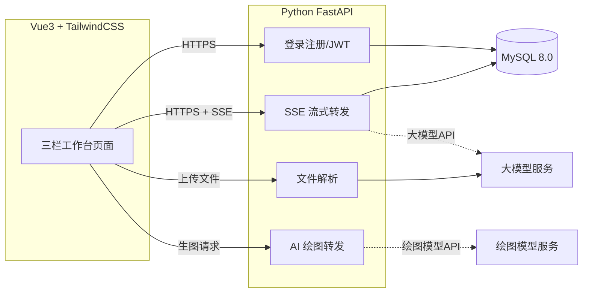

# 轻量AI助手Web端 技术设计文档

- 文档版本：V1.0
- 关联文档：`PRO.md`（产品需求文档）
- 评审状态：已完成（技术栈讨论已确认）
- 更新日期：2026-10-28

## 修订记录

| 版本 | 日期 | 说明 |
| --- | --- | --- |
| V1.0 | 2026-10-28 | 确定技术选型，并落定三项关键决策：会话消息表首期全建、文件解析跑通优先、保留完整全栈架构 |

---

# 1 技术选型总览

| 层次 | 技术选型 | 说明 |
| --- | --- | --- |
| 前端 | Vue3 + TailwindCSS | 快速实现浅色冷调、响应式三栏布局 |
| 后端 | Python FastAPI | 原生异步，天然支持 SSE 流式输出 |
| 数据库 | MySQL 8.0 | 存储账号与会话数据 |
| 鉴权 | JWT | 登录态下发与校验 |
| 密码加密 | bcrypt | 密码不存明文 |
| AI能力 | 大模型API、SSE流式输出、文件解析、AI绘图 | 对接第三方大模型与绘图模型 |

# 2 架构说明

采用**前后端分离的全栈架构**（关键决策：不因"轻量"定位砍掉后端）。AI 调用统一经后端转发，大模型 API Key 保存在后端，不暴露到前端。



# 3 前端设计

- **框架**：Vue3 + TailwindCSS。
- **状态管理**：Pinia（管理会话列表、当前会话、用户登录态、模型参数、主题模式）。
- **UI 组件**：不引入组件库，纯 Tailwind 手写按钮、输入框、下拉、滑块、弹窗、toast、消息气泡等组件，完全对齐自定义设计规范。
- **页面**：首页、AI对话、AI生图、文档解析、关于。
- **布局**：经典三栏布局——左侧会话侧边栏（固定宽度、可折叠）、中间对话主区（弹性宽度、核心视觉）、右侧模型参数面板（固定宽度、可收起）；平板端自动收起侧边栏和参数面板。
- **主题**：浅色为默认，主色调统一冷色系（低饱和冷冰蓝 #6495ED）；支持深色模式，深色同步冷色体系。
- **关键交互**：
  - SSE 流式打字渲染，支持停止生成。
  - Markdown 渲染（标题、列表、引用、表格）。
  - 代码块高亮、一键复制、语言标识。
  - 复制成功、上传成功等轻 toast 提示。
  - 面板展开收起、弹窗淡入淡出，时长 200ms。

# 4 后端设计

- **框架**：Python FastAPI。
- **鉴权**：JWT 登录态，登录/注册/用户中心。
- **流式输出**：通过 SSE 接口将大模型输出流式转发给前端。
- **文件解析**（关键决策：跑通优先，详见第 7 节）：
  - 上传依赖：`python-multipart`。
  - PDF：使用 **PyMuPDF（fitz）** 提取文本。
  - TXT / Markdown：直接读取原文内容。
  - 限制：单文件 ≤ 10MB、≤ 50 页；超出超长截断或友好提示。
  - **不做 RAG**：短文档直接全文进上下文，超长截断。
  - **首期不支持扫描件**（图片型 PDF），上传时提示"暂不支持扫描件"。
- **AI 绘图**：对接绘图模型 API（选型待定，见第 8 节）。

# 5 数据库设计（关键决策：三表首期全建）

相对 PRD 原方案（首期仅建 `user` 表、会话存浏览器本地），本次讨论确认**首期同时建 `chat_session` 与 `chat_message` 表**，登录后会话即持久化到 MySQL，避免本地存储导致切换设备丢记录。

## 5.1 user 用户表

```sql
CREATE TABLE `user` (
  `id` bigint NOT NULL AUTO_INCREMENT COMMENT '用户主键ID',
  `username` varchar(50) NOT NULL COMMENT '用户名，唯一',
  `email` varchar(100) NOT NULL COMMENT '登录邮箱，唯一',
  `password_hash` varchar(255) NOT NULL COMMENT 'bcrypt加密后的密码，不存明文',
  `avatar` varchar(255) DEFAULT '' COMMENT '头像地址，预留',
  `status` tinyint NOT NULL DEFAULT '1' COMMENT '账号状态：1正常 0禁用',
  `created_at` datetime NOT NULL DEFAULT CURRENT_TIMESTAMP COMMENT '注册时间',
  `updated_at` datetime NOT NULL DEFAULT CURRENT_TIMESTAMP ON UPDATE CURRENT_TIMESTAMP COMMENT '信息更新时间',
  PRIMARY KEY (`id`),
  UNIQUE KEY `uk_username` (`username`),
  UNIQUE KEY `uk_email` (`email`)
) ENGINE=InnoDB DEFAULT CHARSET=utf8mb4 COLLATE=utf8mb4_unicode_ci COMMENT='用户账号表';
```

字段说明：`password_hash` 永远存储哈希字符串，前端传原始密码，后端 bcrypt 加密后入库；`utf8mb4` 支持 emoji 与特殊字符；唯一索引保证用户名、邮箱不能重复注册。

## 5.2 chat_session 会话表

```sql
CREATE TABLE `chat_session` (
  `id` bigint AUTO_INCREMENT PRIMARY KEY,
  `user_id` bigint NOT NULL COMMENT '关联user.id',
  `title` varchar(100) NOT NULL COMMENT '会话标题',
  `model_name` varchar(50) DEFAULT '' COMMENT '选用模型',
  `temperature` float DEFAULT 0.7,
  `created_at` datetime DEFAULT CURRENT_TIMESTAMP,
  `updated_at` datetime DEFAULT CURRENT_TIMESTAMP ON UPDATE CURRENT_TIMESTAMP,
  KEY `idx_user_id` (`user_id`)
) ENGINE=InnoDB DEFAULT CHARSET=utf8mb4;
```

## 5.3 chat_message 消息表

```sql
CREATE TABLE `chat_message` (
  `id` bigint AUTO_INCREMENT PRIMARY KEY,
  `session_id` bigint NOT NULL COMMENT '关联会话id',
  `role` varchar(20) NOT NULL COMMENT 'user / assistant',
  `content` longtext NOT NULL COMMENT '消息内容',
  `created_at` datetime DEFAULT CURRENT_TIMESTAMP,
  KEY `idx_session_id` (`session_id`)
) ENGINE=InnoDB DEFAULT CHARSET=utf8mb4;
```

# 6 鉴权与安全

- JWT 登录态：前端存 localStorage 或 cookie；"记住登录状态"有效期 7 天。
- 密码：bcrypt 哈希存储，长度最少 6 位，禁止明文。
- 防暴力破解：后端做简单频率限制。
- 传输：登录等敏感请求必须走 HTTPS。
- API Key 保管：大模型/绘图模型 Key 仅存后端，禁止出现在前端代码。

# 7 关键决策记录

| # | 决策点 | 结论 | 理由 |
| --- | --- | --- | --- |
| 1 | 会话 / 消息表 | 首期全建（`chat_session` + `chat_message`） | 避免本地存储丢会话记录，登录后即云端持久化 |
| 2 | 文件解析 | 跑通优先 | PyMuPDF + 大小/页数限制，不做 RAG，扫描件二期，后续再升级 |
| 3 | 架构形态 | 保留完整全栈 | 学习/作品集价值更高，展示完整全栈能力，不砍后端 |
| 4 | 前端状态与组件 | Pinia + 纯 Tailwind 手写组件，不引入组件库 | 完全对齐自定义冷色设计规范，包体积最小 |

# 8 待定项与后续迭代

- AI 绘图模型 API 选型待定（首期仅预留接入接口）。
- 二期：扫描件 OCR（如 PaddleOCR）、表格结构解析（pdfplumber）。
- 二期：更多文件格式支持、头像上传、云端会话漫游完善。

# 9 风险与备注

- 文件解析能力依赖后端解析服务，首期优先支持 PDF / TXT / Markdown。
- 流式效果依赖后端 SSE 流式接口，接口质量直接影响对话体验。
- 图片生成依赖绘图模型 API。
- 大文件 / 超长文档依赖解析与上下文截断策略，需在接口层做限制与提示。
